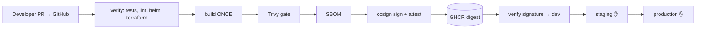
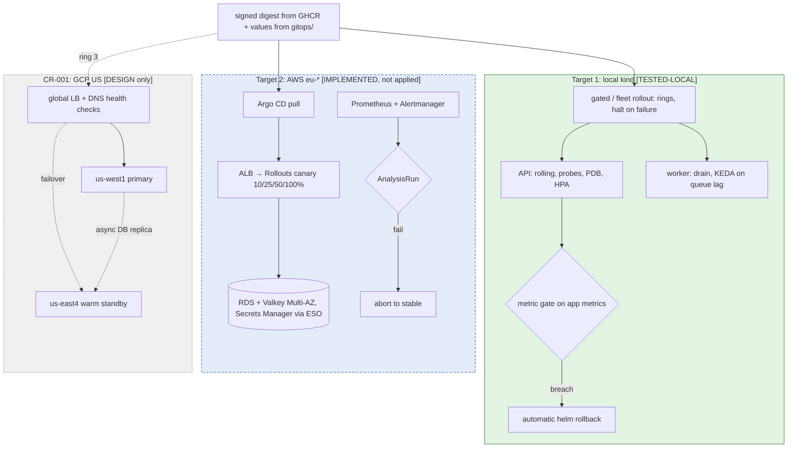

# Architecture — Cloud-Agnostic, Zero-Downtime Deployment Platform

*Author: Girish7010 · 4 Nov 2026 · Max 5 pages. Status labels: **[TESTED-LOCAL]** ran on kind with evidence, **[IMPLEMENTED]** code exists and validates but was not executed against real infrastructure, **[DESIGN]** documented only.*

> **Scope honesty.** The assignment's black-box application was not supplied, so the platform is exercised with a *reference test harness* (`app/`). It implements only the black-box contract (port 8080, `/healthz` `/readyz` `/metrics`, a Redis-queue worker), and the platform depends on nothing beyond that contract. No cloud resources were provisioned. The AWS IaC validates but has not been applied. Everything runtime-related was proven on a local kind cluster (one node, 6.9 GiB laptop).

## 1. Architecture

**(a) Delivery: GitHub Actions, OIDC, no stored keys.**

**(b) Runtime targets: the same signed digest and the same chart everywhere.**

*Legend:* green, solid = ran on kind with evidence; blue, dashed = IaC and config that validate but were never applied; grey, dotted = design in the change request. The delivery pipeline runs on GitHub-hosted runners; its status is in `evidence/submission-2026-11-04/ci-run.txt`.

**Three layers, one contract.**

| Layer | What | Where | Portability |
|---|---|---|---|
| Provider | VPC, Kubernetes, PostgreSQL, Redis, KMS, secrets, IAM/OIDC, state | `infra/modules/aws-stack`, `infra/bootstrap`, `infra/providers/local` | Provider-specific by nature |
| Platform | metrics-server, KEDA, External Secrets, Argo CD/Rollouts, kube-prometheus-stack | `infra/platform` (Helm via Terraform, `target=aws|local`) | Portable (same charts) |
| Application | API + worker chart, tenant values, rings | `deploy/chart`, `gitops/` | Portable (same chart on kind and EKS) |

Each provider root exports the same **output contract**: `cluster_endpoint`, `postgres_host`, `postgres_secret_ref`, `redis_host`, `secret_store`, `region`, `data_residency`. Anything above the provider layer consumes only that contract. Two targets exist: **local kind** (runtime-tested) and **AWS** (validated, not applied). **Not portable:** VPC/NAT design, IAM/IRSA/Pod Identity, RDS and ElastiCache behaviour (failover, parameters, TLS), load balancer controller and annotations, KMS, Secrets Manager, DNS, node autoscaler, pricing and SLAs. A second cloud means writing a new `modules/<cloud>-stack` that honours the same contract; the platform and application layers don't change.

**Automation from an empty account [IMPLEMENTED]:**
1. `infra/bootstrap/aws-state` creates the S3 state bucket (versioned, KMS, TLS-only, **S3 native lock files**) and the GitHub OIDC provider with a read-only *plan* role and an *apply* role restricted to the `production` environment.
2. `infra/live/aws/shared-eu` builds the stack.
3. `infra/platform` installs the add-ons.
4. Argo CD reconciles `gitops/`.

There are no console steps. Drift detection is a nightly `terraform plan -detailed-exitcode` using the OIDC plan role (`.github/workflows/drift-detection.yml`). Secrets: RDS generates and keeps its master password in Secrets Manager (`manage_master_user_password`); the Redis token is an ephemeral write-only value. External Secrets syncs both into Kubernetes, so nothing reaches Git or Terraform state.

## 2. Delivery and deployment

**Pipeline [TESTED in CI: run 41804504092, commit `2eb6bad`, all 5 jobs green]:**
1. **verify:** pytest (14 tests), shellcheck, Helm render of every tenant, and `terraform validate` for every root.
2. **build:** exactly one `docker build` → push to GHCR → Trivy (fails on fixable HIGH/CRITICAL) → CycloneDX SBOM → `cosign sign` + `cosign attest` (keyless, GitHub OIDC).
3. **promote ×3** (`promote.yml`): `cosign verify` and `verify-attestation` against this repository's workflow identity, then move `:dev`, `:staging` and `:production` to **the same digest** with `imagetools create`. The job asserts that the promoted digest equals the built one.

Staging and production are GitHub Environments with required reviewers, which is the approval gate (both were approved manually in that run). Actions are pinned to full commit SHAs. **Metric gates on real traffic** run in-cluster at rollout time, because a runner can't see production metrics.

**API strategy — canary with automated analysis [DESIGN on EKS; TESTED-LOCAL as rolling + analysis].**
- **Canary steps:** 10% → 25% → 50% → 100%, each held for 5 minutes. Every step must pass three checks:
  - 5xx ratio ≤ 1%
  - share of requests slower than 400 ms ≤ 5% (equivalent to p95 < 400 ms)
  - no readiness failures
- **On failure:** abort and return to stable automatically (`gitops/rollouts/`).
- **Locally**, `scripts/gated-rollout.sh` implements the same gates without Argo, in two stages:
  - **Gate 1:** probes plus `helm --rollback-on-failure`.
  - **Gate 2:** per-pod deltas of `http_requests_total` and `http_request_duration_seconds` taken every 15 s; a breach triggers an automatic `helm rollback`.
- **Probes:**
  - startup `/healthz` (60 s budget for startup migrations)
  - readiness `/readyz` (dependency-aware)
  - liveness `/healthz` (process-only, so a Redis outage doesn't cause restart storms)
- **Rolling settings and shutdown:**
  - `maxUnavailable: 0`, `maxSurge: 1`
  - `preStop sleep 10`, then uvicorn graceful shutdown inside a 45 s grace period
  - PDB `minAvailable: 1` (cloud: ≥ 2)
  - spread across zones

**Worker strategy — rolling with drain [TESTED-LOCAL].** Workers pull work, so there is no traffic to shift and no canary. Settings: `maxSurge: 1`, `maxUnavailable: 0`, PDB `maxUnavailable: 1`, `terminationGracePeriodSeconds: 75`. That is the 60 s maximum job plus a 15 s margin, with **no** preStop delay. On SIGTERM the worker stops reading, finishes and **XACKs** the current job, then exits. Delivery is at-least-once: anything unacknowledged is reclaimed with `XAUTOCLAIM` after 120 s (longer than the 60 s job maximum), and a `SET job:done:<id>` marker makes redelivery idempotent.

**GitOps pull [DESIGN] versus what ran locally.** Argo CD ApplicationSet generates one Application per `gitops/tenants/*/values.yaml`. Clusters pull desired state, so CI never holds cluster credentials. Locally, the same values are applied by `scripts/fleet-rollout.sh`, which is pipeline push, because Argo CD wouldn't fit in the laptop's memory alongside the tests.

**Rollout order:** ring 0 shared stack, then ring 1 canary dedicated tenants, then ring 2 the remaining dedicated tenants, then ring 3 the next region (`gitops/fleet.yaml`). The first failed gate rolls that stack back and **halts the fleet** [TESTED-LOCAL].

**Database migrations (black box runs them on startup).**
- **Rule:** every release must be schema-compatible with N-1.
- **Breaking changes** go out as **expand** (additive) → **backfill** (batched) → **contract**. Contract ships at least one release later, after the rollback window, as its own approved release, preceded by a fresh snapshot.
- **Startup migrations:** where the black box allows it, run migrations in a pre-sync Job holding an advisory lock, so N-1 pods never race a destructive DDL. Otherwise the 10% canary step runs the migration while still compatible.
- **Rollback before contract:** redeploy N-1 by digest.
- **Rollback after a contract or destructive migration:** redeploying the old image does **not** restore dropped data. Recovery is a forward-fix or a PITR restore into a *new* instance plus cut-over (`docs/runbooks/database-recovery.md`).

The expand/backfill/contract SQL ran locally on PostgreSQL 16 [TESTED-LOCAL]. Integration with the real app's startup migrations is **not** tested.

## 3. Autoscaling and capacity (assumptions marked *A*)

| Item | Baseline | Peak (15x) | Basis |
|---|---|---|---|
| API rps | 150 | 2,250 | given |
| API pods @ 150 rps/pod *A*, 0.5 vCPU req | 3 (1 per AZ min) | 15 → **20** with 30% headroom | HPA CPU 70% |
| Jobs | — | 20,000/h = **5.6 jobs/s** | given |
| Concurrent jobs (Little's law, avg job 10 s *A*) | — | 56 → **72 worker pods** (1 job/pod) | KEDA on stream lag |
| Sensitivity: avg job 1 s / 30 s / 60 s | — | 6 / 167 / 334 workers | why job-duration data is needed |
| vCPU requests at peak | ~4 | 20×0.5 + 72×0.25 = **28** | → 8 of max 12 m6i.xlarge |
| PostgreSQL connections | ~60 | 20×10 (API pool) + 72×2 (worker) + 10 admin ≈ **354** | cap `max_connections=400`; RDS Proxy at > 400 |

**15x in under 5 minutes.**
- **API:** the HPA allows +100% every 15 s with no stabilisation delay, so 3 → 6 → 12 → 20 pods takes about 4 decisions. Allowing 15 s for metric scrape and 15 s for HPA sync, that is roughly 1.5–2 minutes. The 7.5 vCPU of extra API requests fits on the minimum 3 xlarge nodes (11.7 vCPU allocatable), so **the API path needs no new nodes**.
- **Workers:** worker nodes come from the cluster-autoscaler in about 2–3 minutes. A low-priority overprovisioning deployment keeps one node of headroom.
- **Scale-in:** the API HPA scales down by at most 20% per minute after a 120 s window. KEDA uses a 300 s cooldown. Every evicted worker gets its 75 s grace period, so scale-in never kills an in-flight job [TESTED-LOCAL at 15x ratio].
- **Local results:**
  - 150 rps on kind triggered the HPA (2→5 pods) with p95 < 6 ms.
  - KEDA scaled workers on Redis Streams lag.
- **Not done:** 2,250 rps was **not** run, because it needs cloud capacity (deferred to avoid spend, see `docs/cost-estimate.md`).

## 4. Tenancy and EU residency

**Tenant model.**
- **Shared tenants** live in one shared stack per region.
- **Dedicated tenants** each get their **own provider stack**: their own VPC, EKS, RDS and Valkey, and their own Terraform state key. Both are instances of `modules/aws-stack` plus the same Helm chart.
- **Onboarding** is one reviewed PR:
  - `gitops/tenants/<id>/values.yaml`
  - for dedicated cloud tenants, `infra/live/aws/<id>/` (copy of the template directory)
- **Onboarding time:**
  - Kubernetes layer: **16 s** locally [TESTED-LOCAL]
  - full dedicated AWS stack: about 20–25 minutes, estimated as EKS plus RDS Multi-AZ created in parallel [DESIGN]
  - if the full stack risks exceeding 30 minutes, offer a pre-provisioned warm pool, or a "dedicated namespace on dedicated node group" tier

**Isolation [TESTED-LOCAL: 9/9 checks].**
- Each tenant gets its own namespace with ResourceQuota, LimitRange and Pod Security `baseline`.
- NetworkPolicies:
  - API only from its own namespace or explicitly labelled platform namespaces
  - Redis only from that release's pods
- Each tenant has its own Redis/DB, its own ServiceAccount (no token automount) and its own IRSA/Pod Identity role, scoped to that tenant's secrets only.
- `platform.io/tenant` labels on every object give per-tenant metrics and dashboards.

**EU data never leaves the EU — three layers:**
1. **Terraform validation:** `data_residency=eu` requires an `eu-*` region, and a precondition checks the provider's real region. `terraform test` covers this in 4/4 cases.
2. **Onboarding policy gate:** rejects an EU tenant declaring a US region [TESTED-LOCAL].
3. **Scheduler guard:** `tenant.enforceRegion` adds required node affinity on `topology.kubernetes.io/region`; a pinned pod stayed Pending on a non-EU node [TESTED-LOCAL].

Backups, snapshots, logs and metrics stay in-region: there is no cross-region copy for EU stacks. **Residual risk:** global services (IAM, CloudFront, support access) and CI logs must not contain tenant data.

## 5. Key decisions and rejected alternatives

| # | Decision | Reason and benefit | Rejected alternative | Trade-off accepted |
|---|---|---|---|---|
| 1 | Kubernetes as the portability layer; one Terraform module per provider behind a shared output contract | Provider APIs differ in failure semantics, so explicit modules keep the non-portable parts visible and reviewable. The same chart runs on kind and EKS. | One module with `if provider` branches, or Crossplane only; a PaaS | One provider module to write per cloud (`gcp-stack` for CR-001); cost of running Kubernetes |
| 2 | Build once, promote the **digest**; keyless Cosign plus SBOM attestation, verified at every promotion | The bytes tested in staging are the bytes that run in production. There's no signing key to leak, and tampering fails the promotion. | Rebuild per environment; mutable tags; long-lived signing keys | Depends on Sigstore availability. Any scan failure blocks the release: on 4 Nov the scanner's installer failed (runs 41787637662, 41798284612), so nothing was signed or promoted (see `limitations.md`). Fixed in run 41804504092. |
| 3 | **GitOps pull** (Argo CD ApplicationSet) | CI holds no cluster credentials; drift self-heals; Git is the audit trail | Pipeline push with cluster credentials in CI | Argo CD to run per cluster. Not exercised locally, where pipeline push was used. |
| 4 | **API canary** with Prometheus analysis | Measured locally: a bad *rolling* release exposed **13%** of requests for about 87 s before the gate rolled it back. A 10% canary caps exposure at roughly a tenth of that. | Blue/green, which needs 2× capacity at 2,250 rps and doesn't solve schema coexistence; plain rolling | Needs Argo Rollouts and Prometheus [DESIGN]. A release takes about 20 min (4 steps × 5 min). |
| 5 | **Workers:** rolling, SIGTERM drain, **KEDA on stream lag** | Jobs are I/O-bound and pull-based, so backlog is the real demand signal | CPU-based HPA; canary for workers | At-least-once delivery means duplicates are possible, so the black box must be idempotent |
| 6 | **Dedicated tenants are separate provider stacks** from the same module; shared tenants are namespaces | The 99.95% SLO and residency need independent failure domains | Namespace-only isolation for dedicated tenants; an AWS account per tenant for everyone | About $1.5–2.2k per month per dedicated tenant; a 20–25 min onboarding estimate; more stacks to upgrade |
| 7 | Managed PostgreSQL and Valkey (Multi-AZ, PITR) | Backups, failover and patching become the provider's job | In-cluster StatefulSets, which are used for local only | Provider-specific and non-portable; local tests don't exercise managed failover |
| 8 | Expand/contract migrations plus PITR | A destructive DDL can't be undone by code, so data recovery has to be planned | Down-migrations; "redeploy the old image" | Breaking changes take at least 2 releases; a PITR restore takes hours, with a cut-over |

## 6. Top five risks and mitigations

| Risk | Impact | Likelihood | Mitigation | Recovery / contingency |
|---|---|---|---|---|
| **R1** Black-box startup migrations aren't N-1-compatible | Old and new pods conflict mid-rollout; rollback doesn't restore data | **High** (the brief says some aren't) | Expand/contract policy; pre-sync migration Job with an advisory lock; snapshot gate before contract | Forward-fix, or PITR into a **new** instance plus cut-over (`runbooks/database-recovery.md` §A) |
| **R2** Scale-up too slow (nodes, image pull) to reach 15x within 5 minutes | Raised p95, errors | **Medium**: proven only as a local 15x *ratio* | API peak fits on the minimum nodes; overprovisioning pod; aggressive HPA policy; images pinned and pre-pulled; **must be load-tested at 2,250 rps in cloud** (not done) | Raise HPA minimum and node floor manually; shed load at the edge (`runbooks/api-outage.md`) |
| **R3** PostgreSQL connection exhaustion at peak (about 354 connections) | 5xx across all tenants | **Medium** | Pool limits per pod, `max_connections=400`, RDS Proxy or PgBouncer, alert at 80% of connections | Cut pool sizes or the HPA maximum, enable RDS Proxy (`database-recovery.md` §B) |
| **R4** Job loss or duplicates (at-least-once delivery, queue failover) | Lost or double-processed business jobs | **Medium** | XACK only after completion; idempotency marker; 75 s grace; Multi-AZ Valkey with `noeviction`; **the black box must be idempotent** (unverified) | `XAUTOCLAIM` reclaims unacked jobs after 120 s; re-enqueue from the source (`runbooks/queue-backlog.md`) |
| **R5** EU residency leakage via backups, logs, telemetry or support tooling | Contract or legal breach | **Low** (three guards), but severe | Region validation in three layers; no cross-region replication for EU; in-region logs; periodic placement audit | Security incident process: contain, purge copies outside the EU, notify the tenant per contract |

**Failure modes covered:**

| Failure | Response | Status |
|---|---|---|
| Pod crash | Restart; readiness removes it from endpoints | — |
| AZ loss | Multi-AZ RDS/Valkey; zone spread; PDB | — |
| Bad release | Gates + automatic rollback | tested twice |
| Vulnerable dependency in the image | Trivy gate fails the build (exit 1), so nothing is signed or promoted | tested locally: the pre-fix image fails with 5 HIGH |
| Scanner can't run (install, DB or registry error) | Scan step fails with exit 2 and a distinct error, never "clean" | happened in CI on 4 Nov (installer exit 6, runs 41787637662, 41798284612); fixed by the digest-pinned Trivy container |
| Fleet ring failure | Halt | tested |
| Worker eviction | Drain | tested |
| Redis restart | AOF persistence locally; Multi-AZ in cloud | — |
| Region loss | Out of scope for EU (residency); see the US change request | — |
