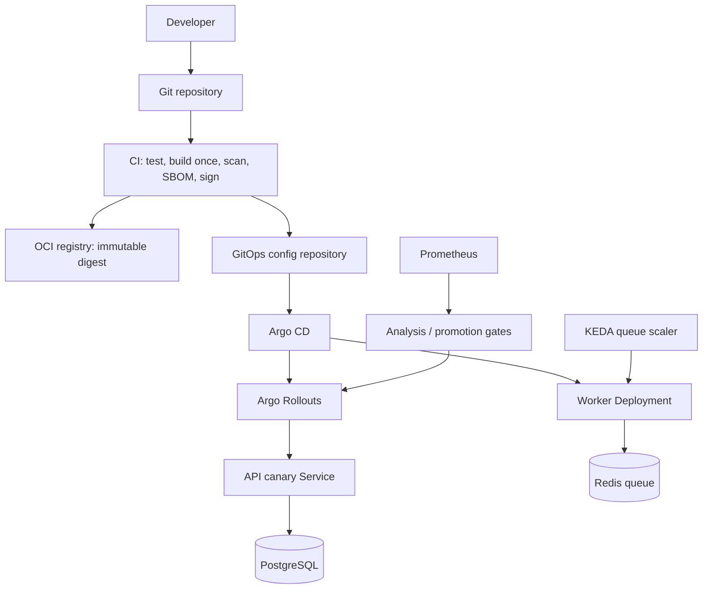

# Architecture (submission draft; keep final version within five pages)

## Layer boundaries
1. Provider: VPC/networking, Kubernetes, managed database/cache, registry, IAM and cloud secrets.
2. Platform: cluster add-ons, ingress, GitOps, rollout controller, autoscaling, observability and policy.
3. Application: API and worker deployment values, service accounts, probes, resources and tenant configuration.

## Decisions and rejected alternatives
1. **Terraform modules per provider** rather than one giant provider-conditional module: isolates provider-specific APIs and reduces hidden coupling.
2. **GitOps pull deployment** rather than long-lived CI credentials with direct cluster push: cluster reconciles reviewed desired state.
3. **Canary API rollout** rather than immediate rolling replacement: controlled exposure and metric-based abort.
4. **Worker rolling/drain** rather than API-style traffic canary: queue consumers need graceful completion and acknowledgement semantics.
5. **Expand/contract database changes** rather than relying on down-migrations: destructive schema rollback is often unsafe.
6. **KEDA queue scaling** rather than CPU-only worker HPA: queue backlog reflects work demand better than CPU.

## Top five risks
- Incompatible startup migrations can prevent old and new versions from coexisting.
- Insufficient warm compute or slow node provisioning can miss the five-minute scale target.
- PostgreSQL connection exhaustion under 15x load.
- Redis queue durability/configuration or worker acknowledgement bugs can lose or duplicate jobs.
- Cross-region replication, backups, logs or telemetry can violate EU residency.

## Portability limits
Kubernetes workloads and Helm are relatively portable. VPCs, IAM/workload identity, managed database/cache behavior, load balancers, KMS, secret managers, autoscalers, DNS, regional replication, pricing and support SLAs remain provider-specific.
