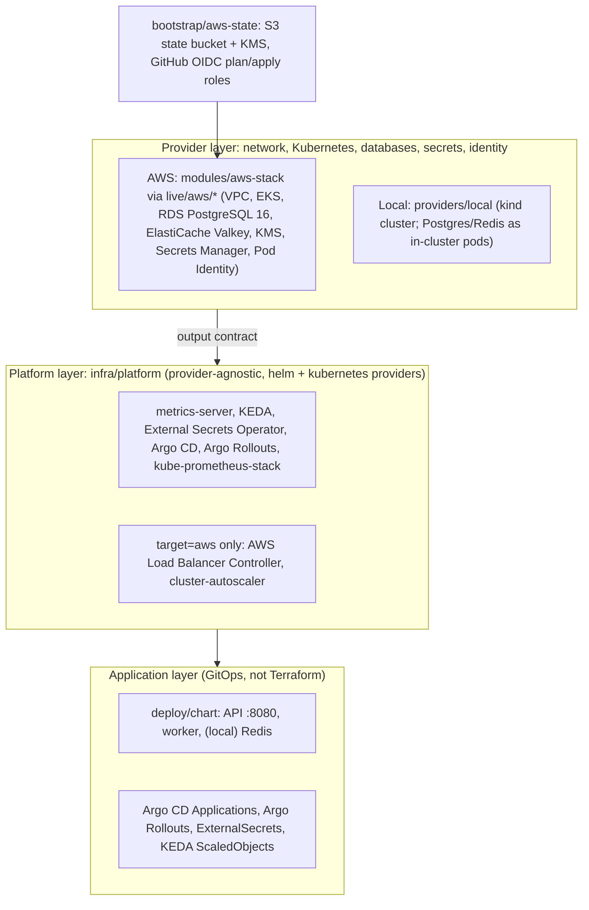

# Infrastructure as Code

**Status: Validated with terraform validate; NOT applied; no cloud resources exist.**
(Evidence: `evidence/submission-2026-11-04/terraform-validation.txt`.)

## Layers



```
infra/
  bootstrap/aws-state/          remote state + CI identities (local state, run once by an admin)
  modules/aws-stack/            AWS provider layer; one instance = one stack
  live/aws/shared-eu/           shared multi-tenant stack, eu-central-1   (state key aws/shared-eu/...)
  live/aws/dedicated-acme-eu/   example dedicated tenant, eu-west-1       (state key aws/dedicated-acme-eu/...)
  providers/aws/                generic tfvars-driven root for ad-hoc/nonprod stacks
  providers/local/              kind target, same output contract
  platform/                     cluster add-ons for either target
  tenants/                      how tenants are described (README)
```

Container registry is **GHCR** (images are built and pushed by GitHub Actions),
so no ECR repository is created. Image references are pinned by digest in the
GitOps values.

## Output contract

Both provider targets expose the same outputs; the platform layer and GitOps
values only consume these names.

| Output | AWS (`modules/aws-stack`) | Local (`providers/local`) |
|---|---|---|
| `cluster_name` | EKS cluster name (= stack name) | `devops-assignment` |
| `cluster_endpoint` | EKS API endpoint | kind API endpoint |
| `kubeconfig_command` | `aws eks update-kubeconfig --region … --name … --alias …` | `kind export kubeconfig --name devops-assignment` |
| `postgres_host` | RDS endpoint address | `migration-postgres.devops-platform.svc` |
| `postgres_port` | `5432` | `5432` |
| `postgres_secret_ref` | ARN of the RDS-managed secret in Secrets Manager | `devops-platform/migration-db-secret` |
| `redis_host` | ElastiCache primary endpoint (TLS) | `devops-platform-redis.devops-platform.svc` |
| `redis_port` | `6379` | `6379` |
| `redis_secret_ref` | ARN of `<stack>/redis-auth` secret | `null` (no AUTH locally) |
| `secret_store` | `aws-secrets-manager` | `kubernetes` |
| `region` | e.g. `eu-central-1` | `local` |
| `data_residency` | `eu` / `us` | `local` |

AWS extras (not part of the contract): `vpc_id`, `kms_key_arn` (module only).

## Empty account to running platform (no console steps)

Prerequisite: an admin IAM identity on the CLI for step 1 only.

1. **Bootstrap** (once per account, local state):
   ```bash
   cd infra/bootstrap/aws-state
   terraform init
   terraform apply -var state_bucket_name=<org>-tfstate-<account-id>
   ```
   Outputs: bucket, state KMS key, `github_plan_role_arn`, `github_apply_role_arn`.
   In GitHub: create environment `production` with required reviewers; store the
   role ARNs and bucket name as repository variables (not secrets; they are not
   sensitive).
2. **Provider layer**, shared stack (CI with the apply role, or an admin):
   ```bash
   cd infra/live/aws/shared-eu
   cp backend.hcl.example backend.hcl   # fill from step 1 outputs
   terraform init -backend-config=backend.hcl
   terraform plan -out=tfplan && terraform apply tfplan
   ```
   Then each dedicated tenant directory the same way.
3. **Platform layer**:
   ```bash
   $(terraform -chdir=infra/live/aws/shared-eu output -raw kubeconfig_command)
   cd infra/platform && cp backend.s3.tf.example backend.tf
   terraform init -backend-config=../live/aws/shared-eu/backend.hcl
   terraform apply -var-file=aws-shared-eu.tfvars   # from aws-shared-eu.tfvars.example
   ```
4. **GitOps**: apply the Argo CD root Application (repo path with the app
   chart + per-tenant values). From here Argo CD deploys the API/worker,
   ClusterSecretStore/ExternalSecrets and KEDA/Rollouts objects. Terraform no
   longer touches the app.

Local equivalent: `providers/local` apply, then `platform` with
`-var-file=local.tfvars` (from `local.tfvars.example`), then
`helm install devops-platform deploy/chart -n devops-platform` and
`kubectl apply -f database/postgres-test.yaml`.

## State, locking, drift

- **Remote state**: one S3 bucket (versioned, SSE-KMS, public access blocked,
  TLS-only policy, noncurrent versions expire after 90 days). Each root has its
  own `key`, so a tenant's state is isolated from every other stack.
- **Locking**: S3 native lock files (`use_lockfile = true`, Terraform >= 1.10);
  no DynamoDB table.
- **No real identifiers in Git**: `backend "s3" {}` is a partial config;
  bucket/region/KMS key come from an uncommitted `backend.hcl`
  (`*.example` files are committed, `backend.hcl` is gitignored in `infra/.gitignore`).
- **Drift detection**: `.github/workflows/drift-detection.yml` (maintained
  separately) runs on a schedule, assumes the read-only `github-terraform-plan`
  role through GitHub OIDC and runs, per root,
  `terraform plan -detailed-exitcode -lock-timeout=5m`. Exit code `0` = no
  drift, `2` = drift (job fails / opens an issue), `1` = error. The plan role
  can read everything but write only `*.tflock` objects, so drift detection
  can never change infrastructure. Applies only run in the `production`
  GitHub environment with the apply role, after review.

## Secrets

Nothing secret is in Git, tfvars or Terraform state for the provider layer:

1. **PostgreSQL**: `manage_master_user_password = true`. RDS generates and
   rotates the password in Secrets Manager (encrypted with the stack KMS key);
   Terraform only knows the secret ARN (`postgres_secret_ref`).
2. **Redis AUTH**: generated as an `ephemeral` value and passed only to
   write-only arguments (`auth_token_wo`, `secret_string_wo`), so it is not
   persisted in state. Rotate by bumping `redis_auth_token_version`.
3. **Into the cluster**: External Secrets Operator runs with an EKS Pod
   Identity role that can `GetSecretValue` on exactly those two secrets and
   `kms:Decrypt` with the stack key. A `ClusterSecretStore`
   (`provider: aws`, service `SecretsManager`) plus `ExternalSecret`s (via
   GitOps) materialise Kubernetes Secrets for the app.
4. Exception, documented: the Grafana admin password in `infra/platform`
   state (`random_password`), and the kind client key in local state.

## Data residency

- `modules/aws-stack` validates `data_residency = "eu"` => region `eu-*`
  (and `us` => `us-*`) at plan time, and a precondition checks that the aws
  provider is really configured for `var.region`.
- RDS automated backups/snapshots and ElastiCache snapshots stay in the stack's
  region; no cross-region backup replication or global datastore is configured.
- State for all stacks is in the EU bucket (eu-central-1); it contains resource
  metadata only, not tenant data.
- Every resource is tagged `tenant_id`, `data_residency`, `deployment_mode`.

## Portability matrix

| Concern | Portable (same on AWS and kind) | Provider-specific (AWS implementation) |
|---|---|---|
| Kubernetes workloads, Helm chart, Argo CD/Rollouts, KEDA, Prometheus | yes | - |
| Output contract / platform layer code | yes (`target` toggles 2 controllers + 1 flag) | - |
| Network | - | VPC, subnets, NAT, security groups (kind: Docker bridge) |
| Identity | - | IAM, EKS Pod Identity, GitHub OIDC trust (kind: none) |
| PostgreSQL | protocol + schema/migrations | RDS Multi-AZ, PITR, parameter groups (kind: single pod) |
| Redis | protocol (Valkey = Redis 7.2 compatible) | ElastiCache replication group, TLS + AUTH (kind: single pod, no AUTH/TLS) |
| Load balancing | Kubernetes `Service`/`Ingress` objects | AWS Load Balancer Controller, ALB/NLB annotations |
| Encryption keys | - | KMS (kind: none) |
| Secrets backend | ESO `ExternalSecret` objects | Secrets Manager `ClusterSecretStore` (kind: plain Secrets) |
| DNS / TLS certs | - | Route 53 / ACM (not implemented yet) |
| Node autoscaling | - | cluster-autoscaler on managed node groups (kind: fixed nodes) |
| Remote state/locking | - | S3 backend (another cloud needs its own backend) |

Porting to another cloud = a new `modules/<cloud>-stack` producing the same
outputs; platform and application layers are unchanged except for the
`target`-specific controllers.

## Known gaps / next steps

- Karpenter instead of cluster-autoscaler (faster scale-up for the 15x peak, Spot).
- Least-privilege PostgreSQL application role (app currently would use the
  RDS master secret), or RDS Proxy/PgBouncer if connection count grows.
- Permissions boundary for roles created by the apply role.
- Restrict `cluster_endpoint_public_cidrs` (currently `0.0.0.0/0` in live roots)
  or move CI to a self-hosted runner in the VPC.
- Route 53 + ACM + external-dns; EBS CSI driver for persistent Prometheus storage;
  platform pods pinned to the `system` node group.
- The app is a black box: TLS to Redis (`rediss://`) and connection pool sizes
  must be confirmed against the real image.
